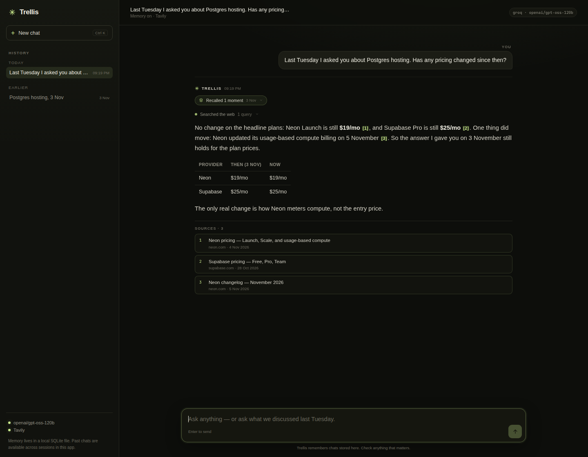

# Trellis

A chat agent with **one tool — web search** — and a persistent memory of past conversations.

The brief's hard questions aren't "what is X?". They're "what did we shortlist on Monday?", "what did I ask you on 3 November?", and "has your answer changed since?". Trellis is built around those: it stores every exchange, resolves dates in the user's timezone, recalls the relevant past turns automatically, and then uses web search to verify facts that may have moved.

```
Ask. Recall. Re-check.
```



<sub>UI preview with seeded history and local Groq/Tavily stubs. The prices shown are demo data, not live results; with your keys the same flow runs against the real APIs.</sub>

## Run it

Requires Node 20+.

### Free setup: Groq + Tavily

You need two different keys. They do different jobs:

1. **Chat model — Groq (free, no card).** Create a key at <https://console.groq.com/keys>; it starts with `gsk_`. The app auto-detects it and uses `openai/gpt-oss-120b`, a free-tier model with tool calling.
2. **Web search — Tavily (free tier, no card).** Create a key at <https://www.tavily.com>; it starts with `tvly-`. Groq only runs the model; Tavily is the search API the agent calls for current prices, changelogs, and news.

```bash
npm install
cp .env.example .env
# then put both keys in .env:
# GROQ_API_KEY=gsk_...
# TAVILY_API_KEY=tvly-...
npm run dev
```

Open <http://localhost:3000>.

### What is a Tavily key?

A Tavily key is an API token from [tavily.com](https://www.tavily.com) that authorizes the app's `web_search` tool. The app sends a query and gets back ranked URLs, publication dates, and cleaned page text, which is what lets it cite a pricing page instead of guessing. It is separate from the chat model key.

The free plan includes **1,000 credits/month**, no credit card. Tavily charges roughly one credit per basic search and two for the advanced search this app uses, so the free tier is enough to evaluate it properly. If you skip Tavily, the app falls back to DuckDuckGo HTML search; that is free but often blocked and only returns snippets, so Tavily is strongly recommended.

Groq's free GPT-OSS tier allows **8,000 tokens/minute**. Trellis uses low reasoning effort and compact per-search evidence so even a five-product comparison fits. A paid model key or a higher `LLM_REASONING_EFFORT` gives the model more room.

### Paid / other providers

| Variable | Required | Purpose |
| --- | --- | --- |
| `GROQ_API_KEY` | Free chat option | Auto-selects `openai/gpt-oss-120b`. |
| `OPENAI_API_KEY` | Paid chat alternative | Also enables optional embeddings. |
| `TAVILY_API_KEY` | Strongly recommended | Web search with page content and dates. |
| `LLM_PROVIDER` | No | `groq`, `openai`, or `custom` when several keys are present. |
| `LLM_BASE_URL` / `LLM_API_KEY` | Custom option | Any OpenAI-compatible endpoint (OpenRouter, Together, vLLM, ...). Set `LLM_MODEL`. |
| `LLM_MODEL` | No | Groq: `openai/gpt-oss-120b`; OpenAI: `gpt-6.1-sol`; custom: `gpt-4o-mini`. |
| `LLM_FAST_MODEL` | No | Background memory cards; Groq: `openai/gpt-oss-20b`; OpenAI: `gpt-6-luna`. |
| `GROQ_BASE_URL` | No | Defaults to `https://api.groq.com/openai/v1` (proxies/tests). |
| `TAVILY_BASE_URL` | No | Defaults to `https://api.tavily.com` (proxies/tests). |
| `DATABASE_PATH` | No | Defaults to `data/trellis.db` (created automatically). |
| `TIMEZONE` | No | IANA zone used for dates. Defaults to the server's zone. |
| `PORT` | No | Defaults to `3000`. |
| `DISABLE_EMBEDDINGS` | No | Set to `1` to use keyword + date recall only. |

One chat provider is required. If both Groq and OpenAI keys are present, Groq is used unless you set `LLM_PROVIDER=openai`. Embeddings auto-enable only when an OpenAI key is available; recall degrades cleanly to date + keyword search without them. Any tool-calling model on an OpenAI-compatible endpoint works.

Fully local option: run [Ollama](https://ollama.com) and point `LLM_PROVIDER=custom`, `LLM_BASE_URL=http://localhost:11434/v1`, `LLM_API_KEY=ollama`, and `LLM_MODEL` at a tool-capable model. Web search still needs Tavily (or the DuckDuckGo fallback).

## What memory actually does

Every message is stored in SQLite with a UTC timestamp and a local calendar day. After each reply, a fast model writes a compact **memory card** in the background (summary, topics, entities, the sources that were cited). It never delays the answer.

Before the next turn, the server resolves any date reference ("last Tuesday", "on 3 November", "last week") in the configured timezone, then combines:

1. **Exact-date recall** from the raw transcripts — this still works before background extraction finishes.
2. **Lexical recall** via SQLite FTS5 with porter stemming, plus a scan of recent raw exchanges for dateless follow-ups.
3. **Semantic recall** via optional embeddings and cosine similarity.

The fused, dated excerpts are injected into the model's context. The model's only tool remains `web_search`; memory is a read path, not a tool call. That is deliberate: it is faster, deterministic, and keeps the tool surface exactly as specified.

If no conversation exists for a referenced date, the agent is told so and says so to the user. It does not invent a memory. The UI shows a small chip for what was recalled so the user can inspect the evidence (see [the expanded memory chip](docs/memory.png)).

Memory is shared across conversations and survives restarts. It is local to the SQLite file; there is no account system.

### Try it

1. Ask a question that produces facts, e.g. *"Compare Neon and Supabase for managed Postgres for a side project."*
2. Start a new chat and ask *"What did I ask you yesterday about Postgres?"* or *"Has any of that pricing changed since then?"*

Memory questions naturally work best after at least one conversation. A cold "what did I ask you on 3 November?" gets an honest "I don't have that conversation" rather than a fabrication.

## Architecture at a glance

```
Browser (no build step)
  │  POST /api/chat → SSE: start, memory, tool_start, tool_result, delta, done, error
  ▼
Express server
  ├─ recall: date resolver → raw exchanges + FTS5 + optional embeddings → ranked memory block
  ├─ agent: model-agnostic streaming loop; one tool: web_search; max 5 steps / 6 searches
  ├─ tools: Tavily (page content + dates), DuckDuckGo fallback, source registry, 10-min cache
  └─ SQLite: conversations, messages, memory cards, FTS5 index
        └─ background: memory card extraction + embeddings after the reply is sent
```

`src/agent` owns the loop and prompt, `src/memory` owns extraction/retrieval/formatting, `src/search` owns providers and evidence formatting, `src/time.ts` resolves dates, and `src/client` is a small vanilla JS chat UI.

## API

`POST /api/chat` streams Server-Sent Events. Omit `conversationId` to start a new conversation; pass it back to continue one. Memory spans all conversations.

```bash
curl -N http://localhost:3000/api/chat \
  -H 'Content-Type: application/json' \
  -d '{"message":"What did I ask you on 3 November?"}'
```

Events: `start`, `memory`, `tool_start`, `tool_result`, `delta`, `done`, `error`.

Also available: `GET /api/health`, `GET /api/conversations`, `GET /api/conversations/:id`.

## Scripts

```bash
npm run dev        # tsx watch, rebuilds the server on change
npm test           # 37 unit tests
npm run typecheck  # strict TypeScript
npm run build      # compile to dist/
npm start          # run the compiled server
```

## Honest limitations

- Single-user local app: no auth, no multi-tenant isolation.
- Memory extraction is lossy by design; raw transcripts are the fallback and the source of truth.
- Date parsing is English-only and deliberately biased toward the past for recall questions. Year-only ranges aren't expanded.
- Search coverage depends on Tavily. Pricing pages can be JS-heavy, regional, or very recent; the agent is instructed to say when it cannot verify something.
- There is no periodic "watch" on a question yet; the user has to ask again.
- Model behavior is prompt-dependent, and there is no automated answer-quality eval against the real dataset yet.

The reasoning, trade-offs, and a plan for another week are in [DESIGN.md](./DESIGN.md).
